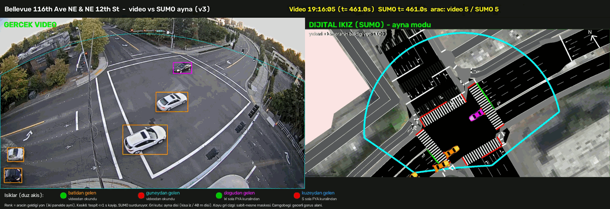

# Bellevue 116th Ave NE & NE 12th St – SUMO dijital ikizi

Bellevue (Washington, ABD) 116th Ave NE & NE 12th St kavşağının [SUMO](https://eclipse.dev/sumo/) ile kurulmuş
dijital ikizi. Gerçek trafik kamerası videosundaki araçlar tespit edilip izlenir, harita koordinatlarına
dönüştürülür ve SUMO'ya aktarılır. Sonuç, gerçek video ile SUMO'nun yan yana ve aynı zaman ekseninde
oynatıldığı bir demodur.



## Veri

- **Kaynak:** [City of Bellevue Traffic Video Dataset](https://github.com/City-of-Bellevue/TrafficVideoDataset).
  Eylül 2017'de beş kavşaktan kaydedilmiş, yaklaşık 101 saatlik 1280×720 video. Videolar Google Drive klasörleri
  üzerinden dağıtılır.
- **Kullanılan kamera:** `Bellevue_116th_NE12th`. Demo, `Bellevue_116th_NE12th__2017-09-10_19-08-25.mp4`
  dosyasının (19:08:25'te başlayan saat) 399–489. saniyelerini kullanır.
- **Video bu depoda yoktur** (`videos/` git dışıdır). Yerelde şu konuma koyun:

  ```
  videos/Bellevue_116th_NE12th__2017-09-10_19-08-25.mp4
  ```

  İndirmek için (kavşağın tüm saatleri `scripts/download_videos.py` içinde listelidir):

  ```bash
  cd scripts
  python download_videos.py --out-dir ../videos --only-hour 2017-09-10_19
  ```

## Sistem nasıl çalışıyor

1. **Tespit + takip:** Ultralytics YOLOv8m (`yolov8m.pt`; araba, motosiklet, otobüs, kamyon sınıfları) ve
   ByteTrack (`bytetrack.yaml`).
   - Rota modu: `scripts/vehicle_tracker.py` kutu merkezlerini yazar (varsayılan güven eşiği 0,35, her 2. kare).
   - Ayna modu: `mirror/detect_window.py` tam kutuları ve kutunun alt-orta noktasını yazar. Her kare işlenir,
     NMS sınıftan bağımsızdır ve tespitler takipten önce sabit-nesne maskesiyle süzülür.
2. **İz birleştirme:** ByteTrack'in kopardığı izler birleştirilir. Rota modunda `scripts/stitch_tracks.py`
   konum tahminine bakar. Ayna modunda `mirror/prepare_mirror.py` ayrıca yön tutarlılığını da kontrol eder ve
   aynı karede çakışan çift kutuları temizler.
3. **Görüntü → harita eşlemesi:**
   - Rota modu: `homography.json` içindeki tek bir homografi kullanılır (`points.csv`'deki noktalardan).
   - Ayna modu: balıkgözü bozulması (division modeli) ile homografi birlikte kestirilir
     (`mirror/fit_mapping.py`, sonuç `mirror/fisheye_mapping.json`). Kestirimde 10 kontrol noktası
     (yaya geçidi uçları ve kavşak köşeleri) ve 6 çizgi kısıtı (kaldırımlar, orta çizgiler) kullanılır;
     bunlar `mirror/control_points.json` dosyasındadır. Doğrulama birini dışarıda bırakma yöntemiyle yapılır.
4. **Bölgeler:** `config.json` görüntüdeki giriş/çıkış/kuyruk poligonlarını ve sinyal kafası kutularını tutar.
   `zone_to_edge.json` bu bölgeleri SUMO kenarlarına bağlar.
5. **İki çalışma modu:**
   - **Rota modu** (senaryo testi için): `scripts/replay_vehicles.py` her gerçek aracı, kavşağa girdiği
     saniyede ve bölgelerden çıkan köken→hedef bilgisiyle bir `<trip>` olarak yazar. Sonrasını SUMO'nun kendi
     araç modeli sürer. Bu modda ışıklar ağın kendi programıyla çalışır, videoyla senkron değildir.
   - **Ayna modu:** her izlenen araç her 0,1 s'de videoda gözlendiği yere konur
     (`traci.vehicle.moveToXY`, `keepRoute=2`) ve izi bitince silinir. Ek olarak:
     - Araçların nereden gelip nereye gittiği bölge etiketlerinden değil, hareketlerinden çıkarılır.
     - Yalnızca kavşak merkezine 40 m içindeki **geçerli bölge** kullanılır.
     - Kollarda araç aynı yönde akan en yakın SUMO şeridine kaydırılır (en fazla 6 m) ve o şeride kilitlenir.
       Şerit ancak ham konum şerit sınırını 1,0 m aşıp 1,0 s dışarıda kalırsa değişir (histerezis).
     - Her kol için ölçülen sistematik yan kayma düzeltilir.
     - Tüm video taranarak bir **sabit-nesne maskesi** kurulur (`mirror/build_static_mask.py`). Bu maske
       sinyal kafalarını ve yoldaki ok işaretlerini araç tespitinden çıkarır.
6. **Sinyaller** (`mirror/signal_reader.py`, `mirror/infer_signals.py`):
   - Kameraya bakan kafalar **lamba lamba** okunur: doğu kolundaki direk batı yaklaşımını, kuzey kolundaki
     4 kafalı direk güney yaklaşımını gösterir.
   - Kameraya arkası dönük kafalar (doğu ve kuzey yaklaşımları) çıkarımla bulunur: karşı yönün sola dönüş
     oku yanıp sönen sarıysa bu yaklaşımın düz akışı yeşildir. Bu sonuç araçların dur-kalk hareketiyle
     kontrol edilir.
   - Durumlar her adımda `traci.trafficlight.setRedYellowGreenState` ile SUMO'ya uygulanır.

## Klasör yapısı

| Yol | İçerik |
|---|---|
| `network/` | OSM verisi, SUMO ağı (`bellevue_116th_ne12th.net.xml`), poligonlar; ağ üretimi (`build_network.sh`), uydu görüntüsü indirme, TLS süre ayarı |
| `scripts/` | Rota modu hattı: video indirme, tespit+takip, iz birleştirme, homografi, hız, rota üretimi; canlı çift pencere (`live_dual_window.py`); eski toplu hat (`run_pipeline.sh`) |
| `mirror/` | Ayna modu: maske, maskeli tespit, balıkgözü eşleme, iz hazırlama, sinyal okuma/çıkarım, kayıt, karşılaştırma; tek komutluk hat `make_mirror_demo.sh` |
| `demo/` | İlk (rota tabanlı) demonun betikleri ve eşleme/maske/lamba kontrol görselleri. Üretilen `*.mp4` videolar git dışıdır |
| `sumo/` | `digital_twin.sumocfg`, görünüm ayarları (`view_settings.xml`, açı 30,3°), uydu altlığı (`satellite.png`), TLS dosyaları, `routes_replay_fixed.rou.xml` |
| `config.json` | Görüntüdeki giriş/çıkış/kuyruk bölgeleri ve sinyal kafası kutuları |
| `zone_to_edge.json` | Bölge → SUMO kenarı eşlemesi |
| `homography.json`, `points.csv`, `points_extra.csv` | Rota modunun tek homografisi ve nokta çiftleri |
| `mirror/control_points.json`, `mirror/fisheye_mapping.json` | Ayna modunun kontrol noktaları/çizgileri ve kestirilmiş eşlemesi |
| `docs/` | README görseli |

## Kurulum

Test edilen ortam: Ubuntu 22.04 (WSL2), Python 3.10, SUMO 1.27.1, ffmpeg 4.4 (libx264).

```bash
sudo apt install ffmpeg                      # demo kaydı H.264 için
python3 -m venv scripts/venv                 # make_mirror_demo.sh bu konumu bekler
source scripts/venv/bin/activate
pip install -r requirements.txt              # eclipse-sumo 1.27.1 dahil
export SUMO_HOME=$(python -c "import sumo; print(sumo.SUMO_HOME)")   # ~/.bashrc'ye ekleyin
```

- SUMO'yu sistem paketiyle kurduysanız `SUMO_HOME`'u o kurulumun klasörüne ayarlayın. Betikler
  `traci`/`sumolib` modüllerini `$SUMO_HOME/tools` altından yükler.
- **YOLO ağırlıkları** (`yolov8m.pt`, git dışıdır): ilk kullanımda Ultralytics indirir. Ayna modu ağırlıkları
  `scripts/yolov8m.pt` konumunda arar; önceden indirmek için:
  `cd scripts && python -c "from ultralytics import YOLO; YOLO('yolov8m.pt')"`
- **GPU:** PyTorch'un CUDA sürümü sürücüyle uyumlu olmalıdır. Daha yeni bir CUDA ile derlenmiş torch eski bir
  sürücüde `torch.cuda.is_available() == False` döner (ör. cu130 derlemesi ile CUDA 12.8 sürücüsü). Bu durumda
  sürücüye uygun derlemeyi kurun, ör. `pip install torch --index-url https://download.pytorch.org/whl/cu128`.
  - `mirror/make_mirror_demo.sh` tespit için etkin Python'u kullanır ve CUDA varsa GPU'da çalışır.
    GPU'lu ayrı bir Python ortamı kullanmak için: `GPU_PY=/yol/python bash mirror/make_mirror_demo.sh ...`
  - CPU'da maskeli tespit videonun 1 saniyesi için yaklaşık 25 s sürer.

## Çalıştırma

Aşağıdaki komutlarda sanal ortamın etkin ve `SUMO_HOME`'un tanımlı olduğu varsayılır.

### a) Tespit + takip (tüm saat, rota modu için)

```bash
cd scripts
python vehicle_tracker.py --video ../videos/Bellevue_116th_NE12th__2017-09-10_19-08-25.mp4 \
    --out ../tracks/2017-09-10_19.csv
python stitch_tracks.py --tracks ../tracks/2017-09-10_19.csv --out ../tracks/2017-09-10_19_stitched.csv
python apply_homography.py --tracks ../tracks/2017-09-10_19_stitched.csv --homography ../homography.json \
    --out ../tracks/2017-09-10_19_stitched_real.csv
python speed_extractor.py --tracks ../tracks/2017-09-10_19_stitched_real.csv --out ../speeds_19_stitched.csv
```

### b) Rota modu

```bash
cd scripts
python replay_vehicles.py --tracks ../tracks/2017-09-10_19_stitched_real.csv --config ../config.json \
    --zone-edge-map ../zone_to_edge.json --speeds ../speeds_19_stitched.csv \
    --out ../sumo/routes_replay.rou.xml      # digital_twin.sumocfg bu dosyayı okur
cd ../sumo
sumo-gui -c digital_twin.sumocfg             # GUI'siz: sumo -c digital_twin.sumocfg
```

Saatlik toplu akış (istatistiksel talep) için `scripts/movement_to_routes.py` kullanılabilir (`--help`).

### c) Ayna modu ve yan yana demo

```bash
bash mirror/make_mirror_demo.sh 399 90 ../demo/bellevue_side_by_side_v3.mp4
```

Argümanlar: başlangıç saniyesi, süre (s) ve çıktı yolu. Çıktı yolu `mirror/` klasörüne göredir.

Betik şu adımları sırayla yapar:
1. Sabit-nesne maskesi yoksa tüm videoyu tarayarak üretir (GPU ile yaklaşık 15 dk).
2. 384–504 s aralığında maskeli tespit ve takip yapar.
3. Eşlemeyi yalnızca `fisheye_mapping.json` yoksa yeniden kestirir.
4. İzleri hazırlar (`prepare_mirror.py`).
5. Sinyalleri okur ve çıkarır.
6. Geçerli bölge görselini çizer.
7. `sumo-gui` ile kaydı yapar (`record_mirror_demo.py`; ekranda bir SUMO penceresi açılıp kapanır).
8. Karşılaştırma tablolarını üretir (`compare_counts.py` → `demo/bellevue_v3_counts.md`).

Tek tek adımlar ve seçenekleri için her betikte `--help` kullanılabilir. Örnek:
`python mirror/prepare_mirror.py --lane-margin 1.0 --lane-hold 1.0`

### d) Canlı çift pencere

Önce (b)'deki rota dosyasını üretin. Ardından:

```bash
cd scripts
python live_dual_window.py --video ../videos/Bellevue_116th_NE12th__2017-09-10_19-08-25.mp4 \
    --sumocfg ../sumo/digital_twin.sumocfg
```

`sumo-gui` ve video ayrı pencerelerde senkron oynar; çıkmak için video penceresinde `q` tuşuna basın. Bu görünüm
rota modunu gösterir.

## Sonuçlar

Karşılaştırma aralığı: video 399–489 s (19:15:04–19:16:34).

| Ölçüt | Eski demo | v3 (ayna modu) |
|---|---|---|
| Doğru koldan giren trip oranı (bölge/kenar düzeltmesi, tüm saat) | %7,8 | %98,5 |
| Yaklaşım × dakika sayım farkı (videoya göre mutlak fark toplamı) | 16 | 4 |
| t = 421 s'de bekleyen araç (videoda 0) | 9 | 0 |
| Okunabilir yaklaşımlarda ışık uyumu (3 s'de bir örnek) | batı yaklaşımı %40 (senkron değil) | batı 30/30, güney 30/30 |
| Eşleme hatası (kontrol noktaları, kavşağa ≤ 40 m) | 2,8 m (eski homografi) | ortalama 2,2 m (birini dışarıda bırakma) |

## Sınırlamalar

- OSM'den üretilen ağ gerçek kavşaktan birkaç metre farklıdır:
  - Kuzey ve doğu kollarında SUMO'da 4 giriş şeridi var, videoda 2–3 görünüyor.
  - Yaya geçitlerinin ve köşelerin konumları kayık (güney geçidi yaklaşık 5 m).
  - Kuzey kolu 0,2–12 m'lik kenarlara bölünmüş.
  - Bu yüzden ayna modunda bazı araçlar görüntüde yana kaydırılır; kuzey kolunda bu kayma 6 m'ye kadar çıkar.
- Doğu ve kuzey yaklaşımlarının sinyal kafaları kameraya arkasını dönüyor; bu ışıklar çıkarımla bulunuyor.
- Güney kolu kameranın neredeyse arkasında kalıyor: giriş şeritlerinin yalnızca ilk 4–5 m'si görünüyor ve
  kuyruk ölçülemiyor.
- Eşleme yalnızca kavşak merkezine yaklaşık 40 m içinde geçerli; daha uzaktaki tespitler atılıyor.

## Yol haritası

- Ağı yüksek çözünürlüklü bir ortofotoya göre düzeltmek: şerit sayıları, geçit ve köşe konumları, gereksiz
  ara düğümler.
- Çok sensörlü füzyon: LiDAR, radar ve V2X verileriyle kamerayı birleştirmek.
- Dijital ikiz üzerinde öğrenen sinyal kontrolü.
- Web tabanlı izleme paneli.

## Teşekkür ve kaynaklar

- [City of Bellevue Traffic Video Dataset](https://github.com/City-of-Bellevue/TrafficVideoDataset). Video verisi.
- [Eclipse SUMO](https://eclipse.dev/sumo/). Simülasyon, TraCI ve sumolib.
- [Ultralytics YOLOv8](https://github.com/ultralytics/ultralytics) ve Ultralytics içindeki ByteTrack
  (Zhang ve ark., *ByteTrack: Multi-Object Tracking by Associating Every Detection Box*, ECCV 2022). Tespit ve takip.
- [OpenStreetMap](https://www.openstreetmap.org/) katkıcıları. Ağın kaynak verisi.
- Referans yaklaşım (DiTAT): R. Pradhananga, S. Williams, S. Aygun, L. Chen, Y. Tu, W. Crow, S. Aakur,
  N.-F. Tzeng, *Digital Twin-Aided Municipal Traffic Control*, SUMO Conference Proceedings 6 (2025), 149–161.
  [doi:10.52825/scp.v6i.2619](https://doi.org/10.52825/scp.v6i.2619)
